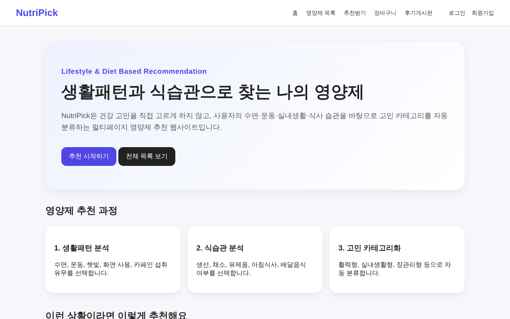
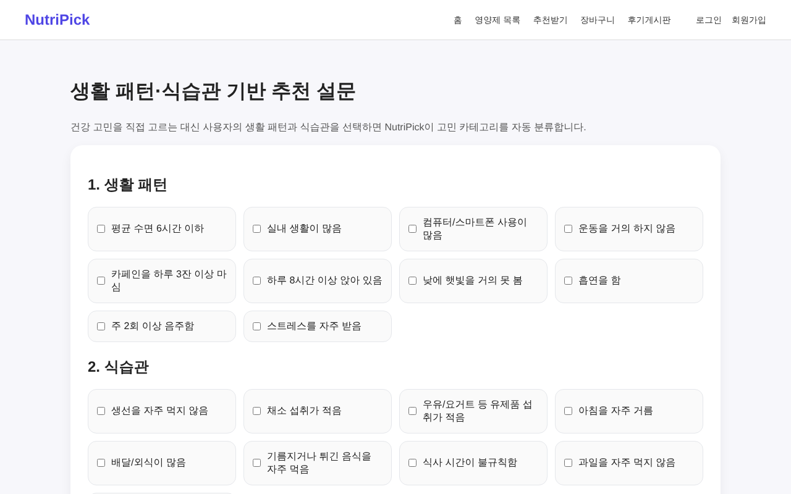
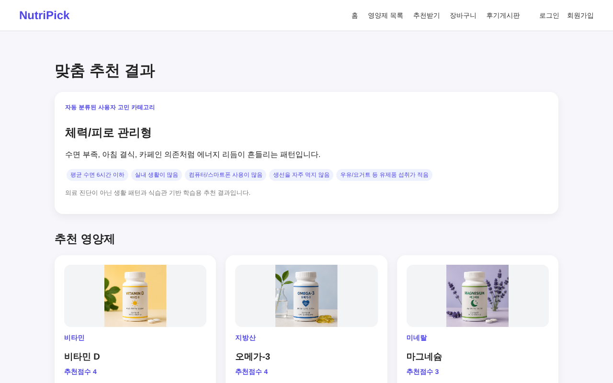
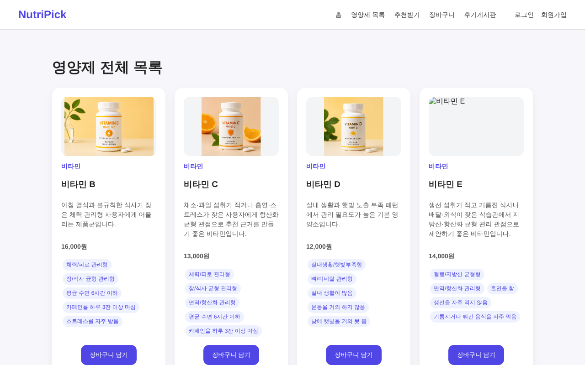

# NutriPick — 생활패턴·식습관 기반 영양제 추천 웹사이트

웹 프로그래밍 수업 최종 프로젝트로, 사용자가 건강 고민을 직접 고르는 대신 **생활패턴과 식습관**을 선택하면 이를 고민 카테고리로 자동 분류해 영양제를 추천하는 **멀티페이지(MPA) 웹사이트**입니다. 단순히 화면을 만드는 것이 아니라, 한 학기 동안 따로 배운 HTML·CSS·JavaScript·DOM 조작을 하나의 서비스로 통합하면서 페이지 간 데이터 전달, 추천 점수 설계, 회원·장바구니 기능을 서버 없이 어떻게 구현했는지를 중심으로 정리했습니다.

> ⚠️ 본 서비스의 추천 결과는 **의료 진단이 아닌 학습용 규칙 기반 추천**이며, 모든 데이터(회원·장바구니·주문·후기)는 브라우저의 localStorage에만 저장됩니다. 실제 서비스 수준의 보안·데이터 관리를 갖춘 것이 아니라는 점을 감안해 주세요.

## 목차
- [프로젝트 개요](#프로젝트-개요)
- [문제 정의](#문제-정의)
- [데이터 설계](#데이터-설계)
- [아키텍처](#아키텍처)
- [추천 로직](#추천-로직)
- [회원 · 장바구니 · 주문](#회원--장바구니--주문)
- [주요 화면](#주요-화면)
- [기술 스택](#기술-스택)
- [저장소 구조](#저장소-구조)
- [실행 방법](#실행-방법)
- [한계 및 향후 개선 방향](#한계-및-향후-개선-방향)

## 프로젝트 개요

| 항목 | 내용 |
|---|---|
| 과제 | 생활패턴·식습관 기반 개인 맞춤 영양제 추천 웹사이트 |
| 구분 | 웹 프로그래밍 최종 프로젝트 · 팀 3인 (노건우 · 송현우 · 양진희) |
| 담당 역할 | (담당한 부분을 입력하세요) |
| 구현 | HTML · CSS · JavaScript(+ jQuery) 기반 MPA, 백엔드 없이 localStorage로 데이터 관리 |
| 규모 | 11개 페이지 · 영양제 12종 · 고민 카테고리 7개 · 설문 항목 19개 |
| 데모 | [https://shw1717.github.io/NutriPick/](https://shw1717.github.io/NutriPick/) |
| 산출물 | 웹사이트 소스 코드, 기획 문서([docs/PLANNING.md](docs/PLANNING.md)), 발표 PPT |

## 문제 정의

프로젝트를 진행하며 아래 세 가지 문제를 중심으로 다뤘습니다.

- **문제 1 (추천 진입 장벽)**: 일반적인 추천 서비스는 "어떤 건강 고민이 있나요?"로 시작하지만, 영양제를 처음 사는 사람은 자신에게 무엇이 필요한지 모릅니다. 그래서 **누구나 답할 수 있는 생활패턴·식습관**(수면, 운동, 햇빛, 식사 등)을 입력으로 받고, 고민은 시스템이 대신 분류하도록 설계했습니다.
- **문제 2 (페이지 간 데이터 전달)**: MPA 구조에서는 페이지가 바뀔 때마다 JavaScript 상태가 초기화됩니다. 설문 → 추천, 로그인 → 장바구니 → 주문 → 마이페이지로 이어지는 데이터를 서버 없이 유지해야 했습니다.
- **문제 3 (확장 가능한 데이터 구조)**: 추천 로직과 상품 카드 출력이 같은 데이터를 쓰고, 이후 AI·백엔드로 확장하더라도 구조를 크게 바꾸지 않도록 데이터를 설계할 필요가 있었습니다.

## 데이터 설계

영양제 하나가 여러 속성(카테고리·생활패턴·식습관·가격 등)을 가지므로 `data.js`에 **JSON 객체 배열**로 관리했습니다. 추천 점수 계산과 상품 카드 출력을 모두 이 배열 하나로 처리합니다.

```js
{
  id: 3, name: "비타민 D", category: "비타민",
  matchCategories: ["indoor", "bone"],   // 연결된 고민 카테고리
  lifestyle: ["실내생활", "햇빛부족"],      // 생활패턴 태그
  diet: ["유제품부족"],                    // 식습관 태그
  price: 12000, image: "../images/vitamin_d.jpg"
}
```

- **영양제 12종**: 비타민·미네랄·지방산·유산균·눈 건강·종합
- **고민 카테고리 7개**: 체력/피로 관리형, 실내생활/햇빛부족형, 눈 건강 관리형, 장/식사 균형 관리형, 뼈/미네랄 관리형, 혈행/지방산 균형형, 면역/항산화 관리형
- **설문 항목 19개**: 생활패턴 10개 + 식습관 9개 — 설문 화면의 체크박스도 이 옵션 배열을 `map`으로 자동 생성

`matchCategories`·`lifestyle`·`diet` 태그가 추천 점수의 기준이 되기 때문에, 태그만 추가하면 추천 로직을 수정하지 않고도 상품을 늘릴 수 있습니다.

## 아키텍처

페이지마다 역할을 하나씩 맡기는 **MPA 구조**로 설계하고, 공통 데이터·로직은 별도 파일로 분리했습니다.

| 파일 | 역할 |
|---|---|
| `data.js` | 고민 카테고리 · 설문 옵션 · 영양제 데이터 |
| `common.js` | 상품 카드 생성 · 장바구니 · 헤더/푸터 로드(jQuery `load()`) |
| `auth.js` | 회원가입 · 로그인 · 로그아웃 · 사용자별 주문 저장 |

페이지가 바뀌어도 **localStorage가 '다리' 역할**을 해서 데이터가 이어집니다.

```
[추천 흐름]
index ──▶ survey ──(선택값 저장)──▶ localStorage ──▶ recommend ──▶ products

[회원 · 커머스 흐름]
login ──▶ cart ──▶ 결제 확인 모달 ──(주문 저장)──▶ mypage
```

## 추천 로직

추천은 2단계로 이루어집니다.

**① 고민 카테고리 자동 분류** — 7개 카테고리마다 키워드를 넣어 두고, 사용자가 고른 항목과 겹치는 개수를 점수로 매깁니다. 점수가 0인 카테고리는 제외하고, 가장 점수가 높은 카테고리를 사용자의 대표 고민으로 화면에 표시합니다.

```js
Object.entries(concernCategories)
  .map(([key, category]) => {
    const score = category.keywords.filter((k) => selectedAll.includes(k)).length;
    return { key, ...category, score };
  })
  .filter((c) => c.score > 0)
  .sort((a, b) => b.score - a.score);
```

**② 추천 점수 계산·정렬** — 영양제별로 생활패턴 일치 수 + 식습관 일치 수 + 고민 카테고리 일치 수를 합산하고, 점수가 높은 순(동점이면 저가 우선)으로 상위 3개를 추천합니다.

```js
score = lifestyleScore + dietScore + categoryScore;

supplements
  .filter((item) => item.score > 0)
  .sort((a, b) => b.score - a.score || a.price - b.price)
  .slice(0, MAX_RESULTS);   // MAX_RESULTS = 3
```

추천 카드에서는 사용자가 선택한 항목과 겹치는 태그를 강조해, **왜 이 영양제가 추천됐는지** 한눈에 보이도록 했습니다.

## 회원 · 장바구니 · 주문

- **회원 시스템**: `register`·`login`·`logout`·`getCurrentUser`를 모두 localStorage 기반으로 구현했습니다. 가입 시 아이디(영문+숫자 7~20자)·비밀번호(6자 이상)·중복·일치 여부를 검증합니다.
- **로그인 게이트**: 장바구니 담기와 후기 작성은 비로그인 상태에서 로그인 페이지로 이동시킵니다.
- **사용자별 데이터 분리**: `nutriCart_{userId}`, `nutriOrders_{userId}`처럼 키에 사용자 ID를 붙여, 같은 브라우저에서도 계정별로 장바구니와 주문 내역이 분리되도록 했습니다.
- **주문 흐름**: 장바구니 → 결제 확인 모달 → 주문 저장 → 완료 모달 → 마이페이지(결제 내역·내 후기) 순으로 이어지며, 새로고침이나 재방문 후에도 데이터가 유지됩니다.

## 주요 화면

 

메인 화면(왼쪽)과 설문 화면(오른쪽)입니다. 메인에서 추천 과정을 3단계로 안내하고, 설문에서는 생활패턴 10개·식습관 9개 항목을 체크합니다.

 

추천 결과 화면(왼쪽)과 전체 목록 화면(오른쪽)입니다. 추천 결과에는 자동 분류된 대표 고민 카테고리와 추천점수가 함께 표시되고, 전체 목록은 공통 카드 함수를 공유해 한 곳만 수정하면 모든 페이지에 반영됩니다.

## 기술 스택

- HTML5 (11개 페이지 문서 구조)
- CSS3 (Flexbox·Grid 반응형 레이아웃, 토스트·모달 UI)
- JavaScript (이벤트 처리, DOM 조작, 배열 고차함수 `map`·`filter`·`sort`)
- jQuery 3.6 (`load()`로 header·footer 공통 조각 삽입)
- localStorage (인증 · 장바구니 · 주문 · 후기 저장)

## 저장소 구조

```
NutriPick/
├── README.md
├── index.html              # GitHub Pages 진입용 (html/index.html로 이동)
├── html/                   # 11개 페이지
│   ├── index.html          # 메인 · 베스트셀러
│   ├── survey.html         # 생활패턴·식습관 설문
│   ├── recommend.html      # 고민 분류 + 추천 결과
│   ├── products.html       # 전체 영양제 목록
│   ├── cart.html           # 장바구니 · 결제
│   ├── board.html          # 후기 게시판
│   ├── write-review.html   # 후기 작성
│   ├── login.html / signup.html
│   ├── mypage.html         # 결제 내역 · 내 후기
│   └── about.html          # 서비스 소개
├── JavaScript/             # data · common · auth + 페이지별 스크립트
├── CSS/                    # style.css + 페이지별 CSS
├── header-footer/          # 공통 header · footer
├── images/                 # 영양제 이미지
├── assets/screenshots/     # README용 화면 캡처
└── docs/
    └── PLANNING.md         # 초기 기획 문서
```

## 실행 방법

1. 저장소를 클론하거나 ZIP으로 내려받습니다.
2. 헤더·푸터를 jQuery `load()`로 불러오기 때문에, HTML 파일을 더블클릭해 `file://`로 열면 헤더·푸터가 표시되지 않습니다. 아래처럼 **로컬 서버로 실행**해 주세요.
   - VS Code **Live Server** 확장으로 `html/index.html` 열기, 또는
   - `python -m http.server 8000` 실행 후 `http://localhost:8000/html/index.html` 접속
3. 또는 별도 설치 없이 [데모 페이지](https://shw1717.github.io/NutriPick/)에서 바로 확인할 수 있습니다.

## 한계 및 향후 개선 방향

- **보안**: 학습 목적상 회원 정보(비밀번호 포함)를 localStorage에 평문으로 저장합니다. 실제 서비스라면 서버에서 비밀번호를 해시(bcrypt 등)로 저장하고 세션·토큰 기반 인증을 적용해야 합니다.
- **데이터 유지**: localStorage는 브라우저별로 저장되어 다른 기기에서는 데이터가 이어지지 않습니다 → **FastAPI + DB** 연동으로 회원·주문·추천 히스토리를 서버에서 관리하는 방향을 검토하고 있습니다.
- **추천 방식**: 키워드 일치 수를 더하는 규칙 기반 점수라 사용자 맥락(나이, 복용 중인 영양제 등)을 반영하지 못합니다 → **AI API 연동**으로 자연어·음성 입력을 분석하고 추천 이유를 자동 생성하는 방향을 검토 중입니다.
- **중복 성분**: 이미 복용 중인 영양제를 고려하지 못합니다 → **OCR**로 영양제 라벨을 인식해 중복 성분을 걸러내는 기능을 검토 중입니다.
- **추천 조건**: 가격대·복용 횟수·제형(알약/젤리 등) 선호를 추천 조건에 추가할 예정입니다.

---

*본 프로젝트는 웹 프로그래밍 수업의 최종 과제로 진행되었으며, 추천 결과는 의료적 판단이 아닌 생활패턴·식습관 키워드에 기반한 학습용 결과입니다. 처음부터 데이터를 태그 기반으로 설계해 두었기 때문에, 핵심 구조를 유지한 채 AI·백엔드 기반으로 확장할 수 있다는 점에 초점을 맞췄습니다.*
